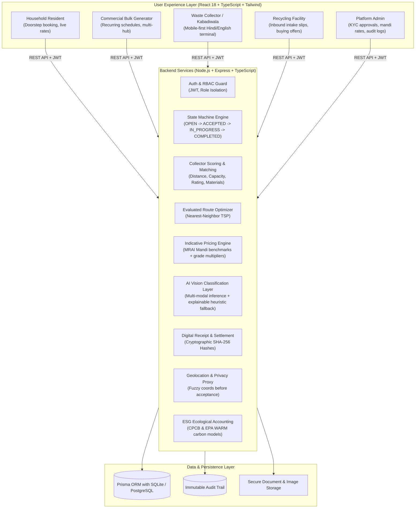
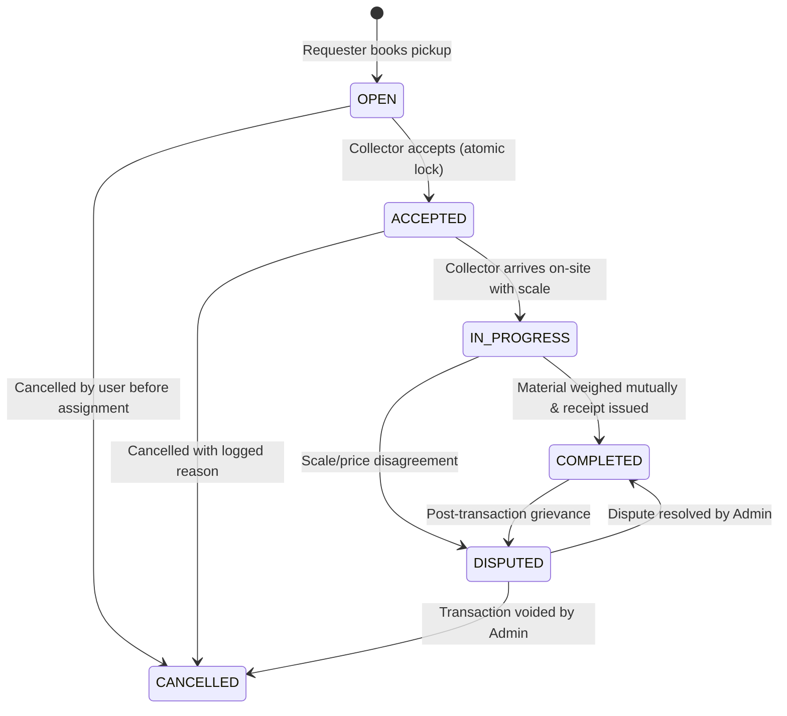

# ScrapSetu: System Architecture & Technical Specifications
**A Digital Bridge to Sustainable Recycling**

---

## 1. Executive Summary

ScrapSetu is a full-stack, inclusive digital platform designed to formalize, transparently price, and digitally integrate India's informal scrap collection ecosystem. By connecting urban households and commercial bulk waste generators directly with local doorstep waste collectors (*kabadiwalas*), aggregators, and certified recycling plants, ScrapSetu solves critical industry bottlenecks:

- **Unfair and Arbitrary Scrap Pricing:** Replaced with open regional benchmark indices.
- **Unreliable Pickup Coordination:** Replaced with proximity-based matching and route planning.
- **Poor Waste Segregation:** Improved via AI-assisted material vision categorization and quality grade incentives.
- **Lack of Digital Ledger:** Replaced with tamper-evident digital receipts secured with cryptographic SHA-256 hashes.
- **Traceability to Formal Recyclers:** Direct intake record linking between collectors and certified processing mills.

---

## 2. Full Architecture Topology

---

## 3. Controlled State Machine

The pickup lifecycle follows a deterministic server-enforced state machine:

---

## 4. Privacy-First Geolocation Engine

- **Open Listings:** Coordinate fuzzing adds an intentional $\pm 400\text{m}$ offset to latitude and longitude for public or unaccepted job views.
- **On Acceptance:** Exact street addresses and telephone numbers are unlocked **only** to the assigned collector.
- **Auditing:** All address unlocks and state transitions are recorded in the central audit ledger.
