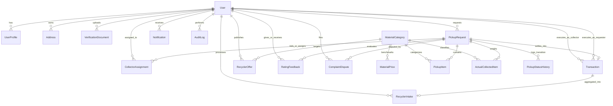

# ScrapSetu: Database Entity-Relationship (ER) Specifications

---

## 1. Relational ER Diagram

---

## 2. Table Schemas & Cardinality Details

### 1. `User`
- `id` (PK, String/UUID)
- `email` (Unique, String)
- `passwordHash` (String, bcrypt 10 rounds)
- `name` (String)
- `phone` (String)
- `role` (`HOUSEHOLD`, `BUSINESS`, `COLLECTOR`, `RECYCLER`, `ADMIN`)
- `languagePref` (`en`, `hi`)
- `isVerified` (Boolean)

### 2. `UserProfile`
- `userId` (FK -> User.id, Unique)
- `businessName` (Nullable String)
- `vehicleType` (`THREE_WHEELER`, `CYCLE_RICKSHAW`, `MINI_TRUCK`, `HAND_CART`)
- `serviceAreaRadiusKm` (Float, default 5.0 km)
- `dailyCapacityKg` (Float)
- `reliabilityRating` (Float, default 5.0)
- `totalPickupsCompleted` (Int)

### 3. `Address`
- `id` (PK, String)
- `userId` (FK -> User.id)
- `label` (String)
- `streetAddress` (String - private until accepted)
- `lat`, `lng` (Float)
- `isDefault` (Boolean)

### 4. `MaterialCategory`
- `id` (PK, String)
- `name` (String, Unique)
- `hindiName` (String)
- `slug` (String, Unique)
- `carbonFactorKg` (Float, CO2 offset factor)
- `treeFactorKg` (Float, mature trees per kg)
- `waterFactorL` (Float, litres conserved)
- `energyFactorKwh` (Float, kWh saved)

### 5. `MaterialPrice`
- `id` (PK, String)
- `categoryId` (FK -> MaterialCategory.id)
- `grade` (String)
- `unit` (String, default "kg")
- `indicativePrice` (Float, baseline INR rate)
- `minPrice`, `maxPrice` (Float)
- `region` (String)
- `source` (String)
- `isDemo` (Boolean)

### 6. `PickupRequest`
- `id` (PK, String)
- `requesterId` (FK -> User.id)
- `addressId` (FK -> Address.id)
- `status` (`OPEN`, `ACCEPTED`, `IN_PROGRESS`, `COMPLETED`, `CANCELLED`, `DISPUTED`)
- `preferredDate`, `preferredTimeSlot` (String)
- `estimatedTotalWeightKg`, `estimatedTotalValue` (Float)
- `isRecurring` (Boolean)

### 7. `Transaction` & Digital Receipts
- `id` (PK, String)
- `pickupRequestId` (FK -> PickupRequest.id, Unique)
- `collectorId`, `requesterId` (FK -> User.id)
- `totalWeightKg`, `totalAmount` (Float)
- `paymentMode` (`CASH`, `UPI`, `BANK_TRANSFER`)
- `receiptNumber` (Unique String, e.g. `REC-2026-JP-00192`)
- `receiptHash` (String, SHA-256 cryptographic proof)
