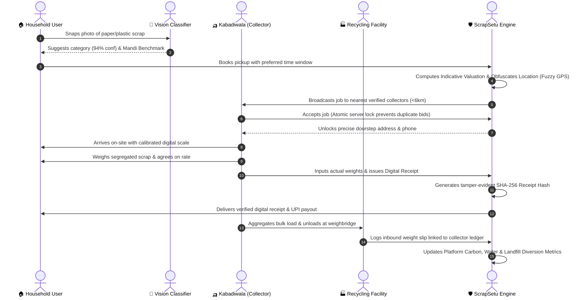

# ScrapSetu: SIH Presentation Package
**Smart India Hackathon & Sustainable Innovation Evaluation Document**

---

## 1. Problem Statement & Real-World Reality

In urban India, approximately **90% to 95%** of municipal recyclable solid waste is channeled through informal waste pickers (*kabadiwalas*). Despite being the backbone of the country's circular economy:

1. **Unfair Scrap Pricing:** Households receive arbitrary low rates due to information asymmetry; collectors often suffer margin cuts from middleman cartels.
2. **Unreliable Doorstep Coordination:** Irregular visiting schedules mean households dump recyclables with mixed wet waste into landfills.
3. **Severe Under-Segregation:** Mixed materials degrade recycler recovery yields and cause health hazards for informal laborers.
4. **Zero Digital Auditability:** Cash-only transactions leave no paper or digital trail for Extended Producer Responsibility (EPR) compliance or municipal planning.

---

## 2. ScrapSetu SIH Presentation-Ready Workflow Diagram

---

## 3. Key Innovations

- **Inclusive Low-Literacy Terminal:** A bilingual (Hindi/English), high-contrast mobile interface with audio-visual cues and large touch targets designed specifically for informal waste workers.
- **Explainable Multi-Tier AI Vision:** Instant waste image categorization with explicit confidence metrics and user confirmation safeguards.
- **Privacy-Preserving Geolocation:** Automatic $\pm 400\text{m}$ coordinate fuzzing hides household coordinates until a verified collector accepts.
- **Cryptographic Audit Ledger:** All weights, prices, and payments are committed with SHA-256 hashes for tamper-proof traceability.
- **Evaluated Route Optimizer:** Uses evaluated Traveling Salesperson (TSP) heuristics to sequence multiple accepted stops, saving fuel and travel time.

---

## 4. Feasibility, Scalability & Social Impact

| Metric | Assessment & Execution Details |
|---|---|
| **Feasibility** | Runs with zero-config standalone persistence (SQLite/PostgreSQL) and lightweight Node/React architecture. No expensive hardware needed—operates seamlessly on ₹7,000 Android phones. |
| **Scalability** | Microservice-ready modular architecture. Stateless JWT authentication, Haversine geospatial indexing, and standard REST endpoints ready for multi-city deployment. |
| **Social Impact** | Formally validates informal *kabadiwalas* as essential green economy professionals, increasing their monthly income by an estimated **25%–35%** by cutting exploitative intermediaries. |
| **Environmental Impact** | Directly supports SDG 11 (Sustainable Cities) and SDG 12 (Responsible Consumption and Production) with documented CPCB/EPA life-cycle carbon metrics. |
